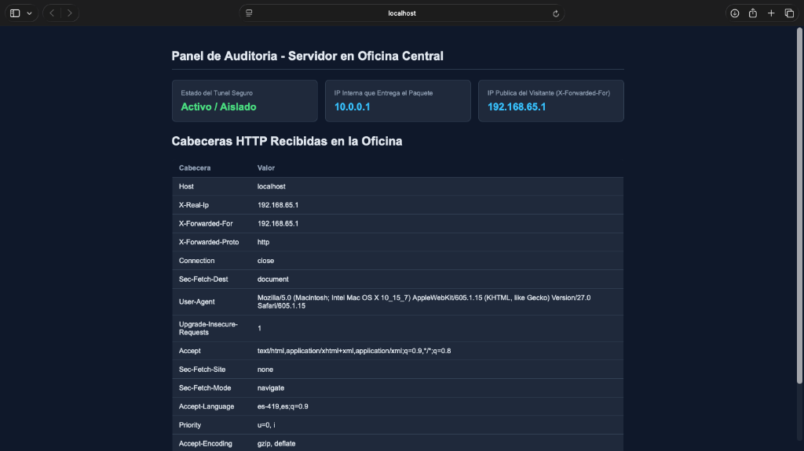
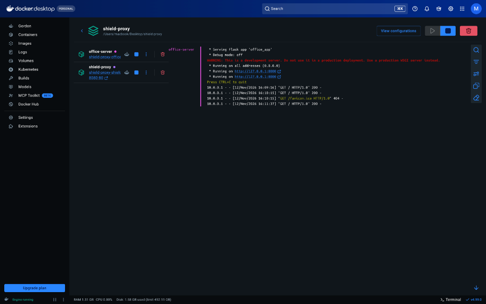
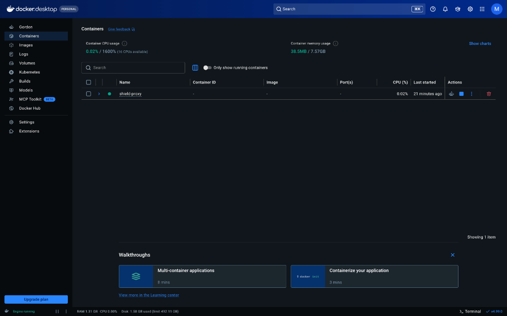

# Corporate Origin Shield & Reverse Proxy Tunnel

Arquitectura de red y seguridad para publicar un servidor web local (en oficina o casa) a traves de un servidor externo (**Nodo Escudo**) conectado por un tunel privado con **WireGuard** y **Nginx** como Reverse Proxy, sin exponer la direccion IP real de origen ni abrir puertos en el router.


---

## Descripcion

Cuando se aloja un servidor fisico dentro de una oficina o casa, publicarlo directamente a internet tiene dos problemas grandes: cualquier persona puede ver la direccion IP publica real del lugar (quedando expuesto a ataques directos) y obliga a abrir puertos en el router (Port Forwarding).

Este proyecto soluciona eso poniendo un **Nodo Escudo** adelante que recibe todas las visitas y las pasa por un tunel privado (`10.0.0.1` -> `10.0.0.2`) hacia el **Nodo Oficina**. Asi, de cara al publico, el servidor parece estar en otro lugar y la IP real de la oficina nunca se revela.

> **Estado actual del proyecto y pruebas:**  
> Para que el trafico salga con una IP publica de otro lugar en internet se requiere conectar el Nodo Escudo mediante una aplicacion de tunel externo o contratando un VPS de pago. Por ahora, el proyecto esta preparado y probado para funcionar en un solo PC usando **Docker Compose**, donde se simulan ambos servidores y la red privada del tunel (las capturas y pruebas de funcionamiento con Docker estan documentadas mas abajo).

---

## Diagrama de Arquitectura

```mermaid
flowchart LR
    subgraph Z1["ZONA 1: INTERNET PUBLICO"]
        direction TB
        U["Usuario / Navegador Web<br/>Peticion HTTP / HTTPS"]
    end

    subgraph Z2["ZONA 2: BORDE EXTERNO (NODO ESCUDO)"]
        direction TB
        FW1["Firewall UFW<br/>Puertos: 80, 443, 51820/UDP"]
        NGX["Nginx Reverse Proxy<br/>- Oculta cabeceras internas<br/>- Agrega X-Forwarded-For<br/>- Pantalla 503 si cae el tunel"]
        WG1["Gateway Tunel (wg0)<br/>IP: 10.0.0.1"]
        FW1 --> NGX --> WG1
    end

    subgraph Z3["ZONA 3: RED LOCAL PRIVADA (NODO OFICINA)"]
        direction TB
        NAT["Router Local / NAT<br/>0 Puertos Abiertos"]
        WG2["Cliente Tunel (wg0)<br/>IP: 10.0.0.2 (Keepalive 25s)"]
        FW2["Firewall Interno<br/>Puerto 8000 solo acepta 10.0.0.1"]
        APP["Servidor de Oficina (Flask)<br/>Escuchando en 10.0.0.2:8000"]
        NAT --> WG2 --> FW2 --> APP
    end

    U ==>|"1. Entra a IP del Escudo"| FW1
    WG1 <==>|"2. Tunel Cifrado Privado<br/>(10.0.0.1 <-> 10.0.0.2)"| NAT

    style Z1 fill:#0f172a,stroke:#38bdf8,stroke-width:2px,color:#f8fafc
    style Z2 fill:#111827,stroke:#f59e0b,stroke-width:2px,color:#f8fafc
    style Z3 fill:#06281e,stroke:#10b981,stroke-width:2px,color:#f8fafc
    style U fill:#1e293b,stroke:#38bdf8,color:#ffffff
    style FW1 fill:#1f2937,stroke:#f59e0b,color:#ffffff
    style NGX fill:#1f2937,stroke:#f59e0b,color:#ffffff
    style WG1 fill:#1f2937,stroke:#f59e0b,color:#ffffff
    style NAT fill:#064e3b,stroke:#10b981,color:#ffffff
    style WG2 fill:#064e3b,stroke:#10b981,color:#ffffff
    style FW2 fill:#064e3b,stroke:#10b981,color:#ffffff
    style APP fill:#064e3b,stroke:#10b981,color:#ffffff
```



### Resumen del recorrido:
1. **El visitante** entra a la direccion del Nodo Escudo pensando que ese es el servidor principal.
2. **El Nodo Escudo (Nginx)** recibe la visita, oculta los datos tecnicos del servidor interno (`Server`, `X-Powered-By`) y le anota la IP del visitante en `X-Forwarded-For`.
3. **El Tunel Privado** lleva el paquete desde `10.0.0.1` hasta `10.0.0.2` sin necesidad de abrir puertos en el router local.
4. **El Nodo Oficina** revisa que el paquete venga unicamente desde `10.0.0.1` y muestra el panel web. Si el tunel se corta, el Nodo Escudo muestra una pantalla de error `503` propia.

---

## Caracteristicas Principales

- **Ocultamiento de IP de Origen**: La direccion IP real de la oficina o del PC local nunca queda expuesta directamente a los visitantes.
- **Sin Abrir Puertos en el Router**: El servidor local inicia la conexion saliente con `PersistentKeepalive = 25` para atravesar el NAT del router.
- **Filtro Estricto en el Puerto 8000**: Tanto el firewall UFW como la aplicacion en Python solo aceptan paquetes que vengan desde `10.0.0.1`.
- **Limpieza de Cabeceras**: Nginx oculta la version del servidor y elimina cabeceras internas antes de responder al navegador.
- **Error 503 Personalizado**: Si se apaga el servidor de la oficina, Nginx muestra una pagina `503.html` de mantenimiento sin filtrar errores internos.
- **Laboratorio Completo en Docker**: Configurado en `docker-compose.yml` para correr ambos nodos en un mismo PC sin gastar en servidores externos.

---

## Estructura de Archivos

```text
shield-proxy/
├── README.md                    # Documentacion del proyecto y pruebas
├── docker-compose.yml           # Simula los 2 servidores y el tunel en un solo PC
├── shield-node/                 # Modulo 1: Nodo Escudo (Reverse Proxy)
│   ├── Dockerfile               # Contenedor de Nginx
│   ├── setup_shield.sh          # Script para instalar en un VPS Linux
│   ├── nginx_shield.conf        # Reglas del Reverse Proxy y cabeceras
│   └── errors/
│       └── 503.html             # Pagina de error cuando se corta el tunel
├── office-node/                 # Modulo 2: Nodo Oficina (Servidor Oculto)
│   ├── Dockerfile               # Contenedor de Python / Flask
│   ├── setup_office.sh          # Script de WireGuard y firewall para oficina
│   ├── office_app.py            # Panel web que muestra el estado del tunel
│   └── requirements.txt         # Librerias de Python
└── capturas/                    # Capturas de las pruebas hechas en Docker
    ├── panel-auditoria.png
    ├── docker-logs-tunel.png
    └── docker-contenedores.png
```

---

## Pruebas Realizadas con Docker

Como para sacar la IP en otra ubicacion real hay que usar una aplicacion de tunel externo o pagar un VPS en la nube, todas las pruebas funcionales del proyecto se hicieron en un PC local con **Docker Desktop**, levantando los dos contenedores conectados por la red interna `10.0.0.0/24`.

### 1. Panel de Auditoria Recibiendo Trafico del Tunel

Entrando a `http://localhost:8080` (el puerto del Nodo Escudo), el contenedor de la oficina responde mostrando que el tunel esta **Activo / Aislado**, que el paquete fue entregado por **`10.0.0.1`** y cuales fueron las cabeceras HTTP recibidas:



---

### 2. Logs del Servidor de Oficina (`office-server`)

En la consola de Docker se ve como el contenedor `office-server` corre en el puerto interno `8000` (aislado del exterior) y recibe las peticiones directamente desde `10.0.0.1`:



---

### 3. Contenedores Activos en Docker Desktop

Vista de `shield-proxy` y `office-server` corriendo al mismo tiempo en el computador durante las pruebas:



---

## Como Probarlo en tu PC con Docker

### 1. Levantar los contenedores

```bash
git clone https://github.com/martin8989-dar/shield-proxy.git
cd shield-proxy
docker compose up --build -d
```

### 2. Ver el panel en el navegador

Abrir en el navegador:

```text
http://localhost:8080
```

### 3. Probar que pasa cuando se corta el tunel (Error 503)

Apagar el contenedor de la oficina:

```bash
docker stop office-server
```

Al recargar `http://localhost:8080`, aparece la pagina personalizada `503 - Servicio Temporalmente No Disponible`.

Para volver a encenderlo:

```bash
docker start office-server
```

Para apagar todo:

```bash
docker compose down
```

---

## Como Usarlo con una IP Externa Real (Con VPS o App de Tunel)

Si mas adelante se quiere publicar hacia internet con una IP distinta a la del PC local, hay dos formas de hacerlo:

1. **Sin pagar (usando una aplicacion de tunel en el PC)**:  
   Con los contenedores de Docker corriendo en el puerto `8080`, se puede usar una herramienta como *Cloudflare Tunnel* o *Pinggy* apuntando a `localhost:8080`. Eso genera un enlace publico con la IP externa de esa aplicacion sin mostrar la IP de tu casa.
2. **Con un VPS externo (ejecutando los scripts Bash)**:  
   Subiendo `shield-node/setup_shield.sh` al VPS publico y `office-node/setup_office.sh` al servidor de la oficina, cruzando las llaves de WireGuard en `/etc/wireguard/wg0.conf` y levantando el servicio con `sudo systemctl enable --now wg-quick@wg0`.

---

## Licencia

Distribuido bajo la Licencia MIT.

---
**Autor:** Martín Celedón  
**Rol:** Ciberseguridad / Blue Team & Desarrollo Python
