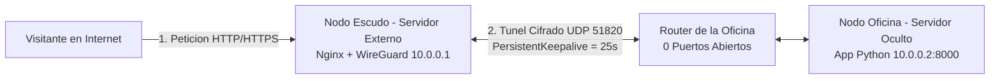

# Corporate Origin Shield & Reverse Proxy Tunnel

Arquitectura de red y seguridad para publicar un servidor web local (en oficina o casa) a traves de un servidor externo (**Nodo Escudo**) conectado por un tunel privado cifrado con **WireGuard** y **Nginx** como Reverse Proxy, sin exponer la direccion IP real de origen ni abrir puertos entrantes en el router.


---

## Descripcion

Cuando una empresa o desarrollador aloja un servidor fisico dentro de su propia oficina, publicarlo directamente a internet presenta dos riesgos importantes: cualquier persona puede descubrir la direccion IP publica real del lugar (quedando expuesto a ataques DDoS o escaneos directos) y obliga a abrir puertos en el router perimetral (Port Forwarding).

Este proyecto resuelve ese problema colocando un **Nodo Escudo** en un servidor externo que recibe todas las visitas publicas y las reenvia por un tunel privado (`10.0.0.0/24`) hacia el **Nodo Oficina**. El servidor de la oficina es quien inicia la conexion hacia afuera, logrando que desde internet parezca que el sistema vive en la IP del escudo y manteniendo la red local completamente oculta y cerrada.

---

## Caracteristicas Principales

- **Ocultamiento de IP de Origen (Origin Shield)**: El dominio publico apunta unicamente al servidor externo. La direccion IP publica real de la oficina nunca aparece en registros DNS ni en las respuestas HTTP.
- **Cero Puertos Abiertos en el Router Local**: El Nodo Oficina levanta el tunel WireGuard como cliente saliente con `PersistentKeepalive = 25`, atravesando el NAT o CGNAT del proveedor de internet sin requerir Port Forwarding.
- **Aislamiento Estricto en Firewall (UFW)**: El servidor de la oficina bloquea cualquier conexion al puerto `8000` que no venga exactamente desde la IP interna del tunel (`10.0.0.1`).
- **Limpieza de Cabeceras en el Borde**: Nginx desactiva `server_tokens` y oculta cabeceras internas como `Server` y `X-Powered-By` para no revelar que tecnologia corre detras.
- **Trazabilidad de Visitantes Reales**: Aunque el trafico llega por el tunel, Nginx inyecta la IP real del visitante en `X-Forwarded-For` y `X-Real-IP` para que la oficina pueda auditar cada acceso.
- **Pagina de Error 503 Personalizada**: Si el tunel con la oficina se corta o entra en mantenimiento, el Nodo Escudo responde con una pantalla `503` propia en menos de 3 segundos, evitando fugas de informacion.
- **Entorno de Demostracion con Docker**: Incluye un laboratorio listo para levantar en un solo computador con dos redes virtuales separadas (una simulando internet y otra privada simulando el tunel).

---

## Diagrama de Arquitectura y Flujo de Trafico



### Paso a paso de como viaja una peticion:
1. **Conexion saliente permanente**: El servidor de la oficina (`10.0.0.2`) se conecta al puerto `51820/UDP` del Nodo Escudo (`10.0.0.1`) y envia un pulso cada 25 segundos para que el router de la oficina mantenga abierto el canal de comunicacion sin abrir puertos de entrada.
2. **Entrada por el Nodo Escudo**: Cuando un visitante entra a la web, se conecta a la IP publica del Nodo Escudo.
3. **Filtrado y reenvio en Nginx**: Nginx recibe la peticion, guarda la IP del visitante en `X-Forwarded-For`, limpia las cabeceras del servidor interno y manda el paquete hacia `http://10.0.0.2:8000` por dentro del tunel.
4. **Verificacion en la oficina**: El firewall local (UFW) y la aplicacion en Python comprueban que el paquete venga de `10.0.0.1` y muestran en pantalla los datos de auditoria.

---

## Arquitectura de Modulos

```text
shield-proxy/
├── README.md                    # Documentacion general y guia de despliegue
├── docker-compose.yml           # Laboratorio local con red publica y red de tunel
├── shield-node/                 # Modulo 1: Servidor Publico Externo (Nodo Escudo)
│   ├── Dockerfile               # Imagen de contenedor para el proxy Nginx
│   ├── setup_shield.sh          # Script de instalacion de WireGuard, Nginx y UFW
│   ├── nginx_shield.conf        # Configuracion de Reverse Proxy y limpieza de cabeceras
│   └── errors/
│       └── 503.html             # Pantalla 503 personalizada cuando el tunel se corta
├── office-node/                 # Modulo 2: Servidor Oculto Local (Nodo Oficina)
│   ├── Dockerfile               # Imagen de contenedor para el servidor interno
│   ├── setup_office.sh          # Script de cliente WireGuard (Keepalive 25) y UFW
│   ├── office_app.py            # Dashboard web en Flask para auditoria del tunel
│   └── requirements.txt         # Dependencias de Python
└── capturas/                    # Evidencias de funcionamiento del sistema
    ├── panel-auditoria.png
    ├── docker-logs-tunel.png
    └── docker-contenedores.png
```

---

## Evidencia y Pruebas del Sistema

### 1. Panel de Auditoria en el Nodo Oficina

Al entrar desde el navegador a traves del Nodo Escudo (`http://localhost:8080`), la aplicacion interna de la oficina muestra en tiempo real el estado de la conexion:


**Detalle de lo que muestra el panel:**
* **Estado del Tunel Seguro (`Activo / Aislado`)**: Confirma que la peticion llego por la red privada del tunel y no desde un acceso directo externo.
* **IP Interna que Entrega el Paquete (`10.0.0.1`)**: Demuestra que quien le entrega los paquetes al servidor de la oficina es el Nodo Escudo.
* **IP Publica del Visitante (`X-Forwarded-For`)**: Muestra la direccion IP de quien hizo la consulta original desde afuera, pasada por Nginx.
* **Tabla de Cabeceras HTTP**: Permite revisar todas las cabeceras que llegaron hasta la oficina y comprobar que en ningun momento se expone la IP real del servidor local.

---

### 2. Registro de Conexiones Internas en el Contenedor Oculto

En los registros de consola del contenedor `office-server` se observa como el servidor escucha en su puerto interno `8000` (sin estar publicado hacia el computador host) y recibe todas las solicitudes exclusivamente desde la IP `10.0.0.1` del Nodo Escudo:


---

### 3. Ejecucion de los Nodos en Docker Desktop

Vista del entorno completo levantado con `docker compose`, donde conviven ambos contenedores conectados por la red privada del tunel con un consumo minimo de memoria y CPU:


---

## Ejecucion de la Demostracion con Docker (En un solo computador)

Para levantar y probar todo el proyecto en tu propio equipo sin necesidad de contratar un VPS externo:

### 1. Clonar el repositorio y levantar los contenedores

```bash
git clone https://github.com/martin8989-dar/shield-proxy.git
cd shield-proxy
docker compose up --build -d
```

### 2. Abrir el panel en el navegador

Entra en tu navegador a:

```text
http://localhost:8080
```

### 3. Simular un corte del tunel (Prueba de Error 503)

Para comprobar que el Nodo Escudo protege la informacion cuando la oficina pierde conexion, apaga el contenedor de la oficina:

```bash
docker stop office-server
```

Al recargar `http://localhost:8080`, Nginx respondera con la pagina `503 - Servicio Temporalmente No Disponible` sin mostrar errores del sistema ni direcciones IP internas.

Para volver a conectar el servidor de la oficina:

```bash
docker start office-server
```

Para apagar el entorno completo:

```bash
docker compose down
```

---

## Despliegue en Servidores Reales (VPS + Oficina)

Si se desea montar en produccion utilizando un VPS con Ubuntu/Debian como **Nodo Escudo** y un computador en la oficina como **Nodo Oficina**:

### 1. Configurar el Nodo Escudo (VPS Publico)

Subir la carpeta `shield-node/` al VPS y ejecutar:

```bash
cd shield-node
sudo bash setup_shield.sh
```

El script instalara WireGuard (`10.0.0.1/24`), configurara Nginx como Reverse Proxy, abrira en el firewall UFW solo los puertos `80`, `443` y `51820/UDP`, y mostrara en pantalla la **llave publica del escudo**.

### 2. Configurar el Nodo Oficina (Servidor Local)

Subir la carpeta `office-node/` al servidor de la oficina y ejecutar:

```bash
cd office-node
sudo bash setup_office.sh
```

1. Copiar la **llave publica de la oficina** que entrega el script al finalizar.
2. En la oficina, editar `/etc/wireguard/wg0.conf` para colocar la IP publica del VPS y la llave publica del Nodo Escudo.
3. En el VPS, editar `/etc/wireguard/wg0.conf` para pegar la llave publica de la oficina.
4. Activar el tunel en ambos equipos:
   ```bash
   sudo systemctl enable --now wg-quick@wg0
   ```
5. Iniciar la aplicacion web en el servidor de la oficina:
   ```bash
   python3 office_app.py
   ```

---

## Licencia

Distribuido bajo la Licencia MIT.

---
**Autor:** Martín Celedón  
**Rol:** Ciberseguridad / Blue Team & Desarrollo Python
